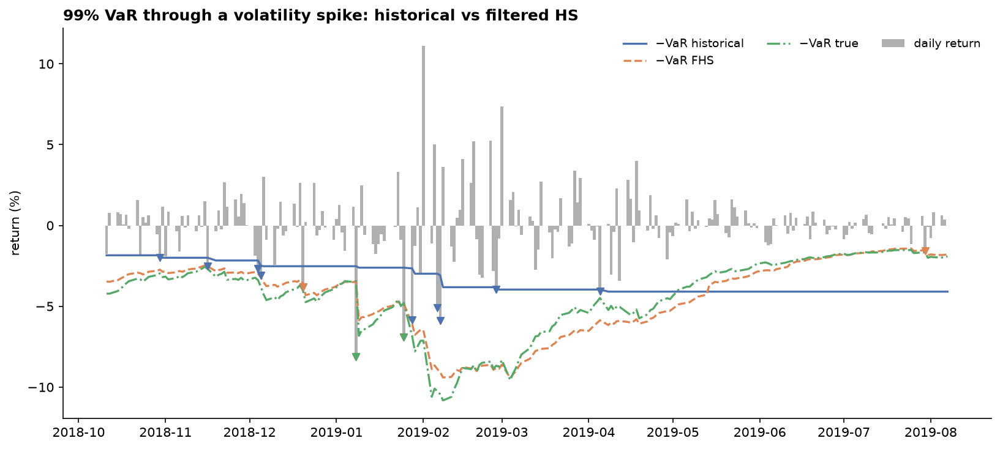
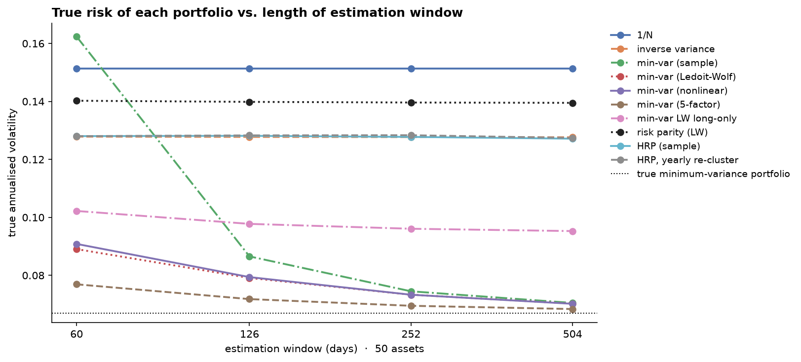

# risk-lab


Market risk and portfolio construction, each validated against a known truth:

- **VaR and Expected Shortfall** by historical simulation, normal, EWMA (RiskMetrics) and
  filtered historical simulation (GARCH + empirical residuals), judged with the formal
  backtests regulators use.
- **Portfolio VaR from a multivariate model**: DCC-GARCH correlations with a t-copula.
- **Nonlinear VaR** for option books: delta-normal vs delta-gamma vs full revaluation.
- **Portfolio construction**: min-variance with sample, Ledoit–Wolf (linear and nonlinear) and
  factor-model covariance, risk parity and Hierarchical Risk Parity, compared on how badly
  estimation error degrades each.

```bash
pip install marketrisk-lab                 # from PyPI; the import is still `import risklab`
pip install -e ".[dev]"                    # or, from a clone, for development
pytest
cd examples
python 01_var_backtesting.py && python 02_portfolio_construction.py && python 03_option_var.py
python 05_multivariate_var.py      # ~4 min
pip install -e "..[data]" && python 04_live_spy_and_etfs.py
```

## Components

| Module | What it does |
|---|---|
| `garch.py` | GARCH(1,1) by quasi-maximum likelihood |
| `var.py` | Rolling out-of-sample VaR/ES: historical, normal, EWMA, filtered historical simulation |
| `multivariate.py` | DCC-GARCH (Engle 2002), t-copula degrees of freedom, rolling portfolio VaR/ES with normal or t-copula shocks |
| `backtests.py` | Kupiec, Christoffersen independence, Basel traffic light, Acerbi–Székely Z2 for ES |
| `nonlinear.py` | Option-book VaR by delta-normal, delta-gamma Monte Carlo and full revaluation |
| `covariance.py` | Sample, Ledoit–Wolf linear shrinkage (matches scikit-learn to 1e-10), Ledoit–Wolf 2020 nonlinear shrinkage, PCA factor model |
| `portfolio.py` | 1/N, inverse variance, min-variance (long-short and long-only), risk parity, HRP with optional fixed leaf order |
| `data.py` | GARCH-t and DCC-t returns with exact true VaR/ES; block covariance matrices; Yahoo loader |

## Study 1: which VaR model survives a backtest?

Returns follow GARCH(1,1) with Student-t (ν = 5) innovations, so the true VaR is known every
day. 2,000 out-of-sample days, 99% one-day VaR, 20 exceptions expected:

| Method | Exceptions | Kupiec p | Independence p | Worst 250-day window | Error vs true VaR |
|---|---|---|---|---|---|
| Historical (500 days) | 36 | 0.001 | 0.028 | 14 (red) | 41% |
| Normal (500 days) | 49 | 0.000 | 0.037 | 16 (red) | 31% |
| EWMA (λ = 0.94) | 32 | 0.013 | 0.539 | 7 (yellow) | 11% |
| **Filtered historical** | **28** | **0.090** | **0.408** | 8 (yellow) | **7%** |
| True VaR | 19 | 0.821 | 0.546 | 6 (yellow) | 0% |

Each method fails for a different reason. Historical simulation adapts too slowly, so its
exceptions cluster in volatile periods (independence fails). The normal model has neither
clustering nor fat tails. EWMA fixes clustering (independence passes) but its normal tails
still produce too many exceptions. Filtered historical simulation handles both and passes.

**Even the true model lands in the yellow zone.** Its worst 250-day window has 6 exceptions,
purely by chance. Traffic-light zones on a single window are noisy evidence.

For 97.5% Expected Shortfall, the Acerbi–Székely Z2 statistic rejects the normal model
(−0.93, below the −0.70 threshold), puts EWMA at the edge (−0.67), and accepts filtered
historical simulation (−0.23, close to the true model's −0.31).



## Study 2: estimation error in portfolio construction

50 assets in 5 correlated sectors, known true covariance, monthly rebalancing over 12 years.
Because the truth is known, each portfolio's real risk is computed exactly as w′Σw. The
"estimation cost" compares each method with the same method given the true covariance.

| Method | Window 60 days: true vol | Estimation cost | Window 504 days: true vol | Monthly turnover (60 → 504) |
|---|---|---|---|---|
| 1/N | 15.1% | 0% | 15.1% | 0 |
| Min-variance, sample cov | **16.2%** | **+142%** | 7.0% | 605% → 21% |
| Min-variance, Ledoit–Wolf | 8.9% | +33% | 7.0% | 116% → 19% |
| Min-variance, nonlinear shrinkage | 9.1% | +36% | 7.0% | 133% → 18% |
| **Min-variance, 5-factor model** | **7.7%** | **+15%** | 6.8% | 79% → 10% |
| Min-variance LW, long-only | 10.2% | +8% | 9.5% | 45% → 6% |
| Risk parity (LW) | 14.0% | 0.5% | 14.0% | 12% → 1% |
| HRP | 12.8% | −0.6% | 12.7% | 34% → 25% |
| **HRP, yearly re-cluster** | 12.8% | −0.6% | 12.7% | **17% → 4%** |

The true minimum-variance portfolio has 6.7% volatility.



**With 60 days of data for 50 assets, sample min-variance is worse than 1/N** and trades
six times its capital every month chasing noise. Ledoit–Wolf shrinkage (intensity 0.16 here)
cuts the excess risk by four-fifths. Risk-based methods barely suffer from estimation error,
but they also don't try to minimise risk.

**Structure beats generic shrinkage.** A five-factor PCA model, which matches the shape of the
true covariance, halves Ledoit–Wolf's estimation cost (+15% vs +33%) and trades less. Nonlinear
shrinkage (Ledoit–Wolf 2020) is closer to the true covariance than linear shrinkage in Frobenius
norm (see the tests), but that doesn't buy a better minimum-variance portfolio here.

**A finding about HRP:** its turnover hardly falls as the window grows (34% → 25%), while every
other method's drops tenfold. Almost all of it comes from the leaf order: small changes in
estimated correlations reorder the clustering tree, and the bisection weights jump with it.
Holding the order fixed removes nearly all of that turnover. Bisecting along the dendrogram
instead of by position, which we expected to help, makes it worse: single-linkage trees are long
chains, and weights compound down them. What works is re-clustering less often than you
rebalance. `hrp(cov, order=hrp_order(...))` with the order refreshed yearly cuts turnover sixfold
at a 504-day window (25% → 4%) with no change in risk.

## Study 3: VaR for option books

99% VaR, spot 100, volatility 25%, three-month options:

| Book | Horizon | Delta-normal | Full revaluation | Delta-normal / full |
|---|---|---|---|---|
| Long 1 share | 10 days | 11.6 | 11.1 | 1.04 |
| Covered call | 10 days | 7.3 | 8.5 | 0.86 |
| Protective put | 10 days | 7.9 | 5.9 | 1.33 |
| **Short ATM straddle** | 1 day | 0.18 | 0.55 | **0.34** |
| **Short ATM straddle** | 10 days | 0.58 | 4.57 | **0.13** |

Delta-normal VaR is wrong in both directions. It understates the risk of short-gamma books
(eight times too small for a delta-hedged short straddle) and overstates it for long-gamma
books. Delta-gamma helps but overshoots, because it ignores the theta a short option earns.

## Study 4: real data

`04_live_spy_and_etfs.py` backtests all four VaR models on SPY through 2008, 2020 and 2022,
and runs the portfolio methods on 10 multi-asset ETFs (equities, bonds, credit, gold,
commodities, REITs) with a rolling one-year covariance and monthly rebalancing. Data end
2025-12-31 so the numbers reproduce.

| SPY, 99% VaR, 2007–2025 | Exceptions (48 expected) | Kupiec p | Independence p | Worst 250 days |
|---|---|---|---|---|
| Historical | 86 | 0.000 | 0.000 | 21 (red) |
| Normal | 142 | 0.000 | 0.000 | 29 (red) |
| EWMA | 116 | 0.000 | 0.030 | 13 (red) |
| **Filtered historical** | **65** | 0.018 | 0.013 | 10 (red) |

Real data are harder than the simulation: every model fails, but the ranking is the same, and
filtered historical simulation has the fewest exceptions by a wide margin.

| ETF portfolio, 2008–2025 | Annual return | Annual vol | Sharpe (rf = 0) | Max drawdown |
|---|---|---|---|---|
| 1/N | 5.6% | 10.4% | 0.58 | −28% |
| Inverse variance | 4.1% | 7.3% | 0.59 | −19% |
| Min-variance LW, long-only | 3.3% | 6.3% | 0.55 | −16% |
| Risk parity | 4.6% | 8.0% | 0.61 | −19% |
| HRP | 4.0% | 7.3% | 0.57 | −18% |

## Study 5: portfolio VaR from a multivariate model

Three assets with GARCH(1,1) volatilities, DCC correlations and multivariate-t shocks (ν = 6),
held in fixed weights 50/30/20. The shocks are elliptical, so the portfolio's true VaR and ES are
known in closed form every day. 2,000 out-of-sample days, 99%:

| Method | Exceptions (20 expected) | Kupiec p | Independence p | VaR error vs true | ES error vs true |
|---|---|---|---|---|---|
| Historical, portfolio returns | 22 | 0.658 | 0.484 | 25% | 22% |
| Filtered historical, portfolio returns | 23 | 0.510 | 0.464 | 8% | 9% |
| DCC-GARCH, normal shocks | 26 | 0.197 | 0.408 | 12% | 22% |
| **DCC-GARCH, t-copula** | **20** | 1.000 | 0.525 | **5%** | **7%** |
| True VaR | 14 | 0.154 | 0.657 | 0% | 0% |

The t-copula model is the most accurate, and the only one that gets ES right without fitting the
portfolio's own history. DCC with normal shocks gets the correlations right but not the joint
tails, so its ES is as wrong as historical simulation's.

**Every method passes every backtest here**, including historical simulation with a 25% error.
Exception counts over eight years can't separate a good model from a mediocre one. Study 1 caught
the bad models only because they were badly wrong; comparing with the truth is much more sensitive.

Filtered historical simulation on the portfolio's own return series is a strong, much cheaper
baseline when weights are fixed. The multivariate model earns its cost when weights change, since
one fit gives the VaR of any portfolio of the same assets.

## Roadmap

- [x] **M1** VaR/ES models and backtests, option VaR, covariance shrinkage, four portfolio methods, three validation studies
- [x] **M2** Nonlinear shrinkage (Ledoit–Wolf 2020) and factor-model covariance
- [x] **M3** Remove HRP's ordering instability from Study 2 (dendrogram bisection tested and rejected; slower re-clustering adopted)
- [x] **M4** Multivariate VaR for portfolios with DCC-GARCH and a t-copula
- [x] **M5** Plug the structured-product pricer in as a nonlinear position: the `Position` protocol,
      full-revaluation VaR and stress tests here; the autocallable book itself is quant-stack study S2

## Scenarios, full revaluation and stress tests (v0.4, M5)

`risklab.scenarios` computes VaR for any position that can price itself under a scenario. Positions
satisfy the `Position` protocol, `value(scenario)`, so a structured note repriced by Monte Carlo in
another library is valued the same way as an option book here, with no import between the two.

```python
import numpy as np
from risklab import Portfolio, OptionPosition, gbm_scenarios, full_revaluation_var, stress_test, ledoit_wolf

book = Portfolio(100.0, 0.2, shares=1, options=[OptionPosition(95, 0.25, False, 1)],
                 vol_fn=lambda K, T: 0.2 - 0.3 * np.log(K / 100), sticky="moneyness")
scenarios = gbm_scenarios(ledoit_wolf(returns)[0], n_scenarios=20_000, horizon_days=10)
full_revaluation_var([book], scenarios, alpha=0.01)     # {"var", "es", "pnl"}
stress_test({"hedged": book})                           # spot -10/-20/-30%, vol +5/+10, combined
```

- **Scenario** is a batch of spot multipliers per underlying, a parallel vol shift, a skew shift
  (vol per unit of ln K/S) and elapsed time. Revaluing with elapsed time includes theta.
- **Generators:**
  - `historical_scenarios` applies realised h-day returns.
  - `gbm_scenarios` draws lognormal moves from any daily covariance.
  - `filtered_historical_scenarios` rescales each historical return by today's GARCH vol over the
    vol on its own day (Hull & White 1998). The scenarios then reflect current volatility while
    keeping the empirical tails.
- **Skew in option books.** `Portfolio(vol_fn=...)` prices each option off a smile, with flat vol
  as the default. When spot moves, the smile can behave in two ways:
  - **Sticky strike:** each option keeps the vol of its strike.
  - **Sticky moneyness:** each option takes the vol of its new moneyness. After a sell-off, a put is
    nearer the money and its vol falls on a downward skew.

  The two rules give different VaR for the same book (Derman 1999), and quant-stack study S5 measures
  the difference.

## Part of quant-stack

risk-lab is one of five independent libraries linked in
[quant-stack](https://github.com/hossainyousuf751/quant-stack). There:

- sp-pricer notes become `Position`s for the VaR of a structured-note book (study S2);
- volsurface surfaces supply `vol_fn` (study S5);
- risk-lab's covariance estimators and allocators run through backtest-lab's engine (study S3).

risk-lab installs and tests on its own.

## Contributing

See [CONTRIBUTING.md](https://github.com/hossainyousuf751/risk-lab/blob/main/CONTRIBUTING.md) for workflow and responsibilities and
[docs/CONVENTIONS.md](https://github.com/hossainyousuf751/risk-lab/blob/main/docs/CONVENTIONS.md) for the technical rules. Every method must be validated
against a known truth.

## References

- Kupiec, P. (1995). Techniques for verifying the accuracy of risk measurement models. *Journal of Derivatives* 3(2).
- Christoffersen, P. (1998). Evaluating interval forecasts. *International Economic Review* 39(4).
- Engle, R. (2002). Dynamic conditional correlation. *Journal of Business & Economic Statistics* 20(3).
- Barone-Adesi, G., Giannopoulos, K. & Vosper, L. (1999). VaR without correlations for portfolios of derivative securities. *Journal of Futures Markets* 19(5).
- Acerbi, C. & Székely, B. (2014). Backtesting Expected Shortfall. *Risk*, December.
- Hull, J. & White, A. (1998). Incorporating volatility updating into the historical simulation method for value-at-risk. *Journal of Risk* 1(1).
- Derman, E. (1999). Regimes of volatility. *Risk* 12(4).
- Ledoit, O. & Wolf, M. (2004). A well-conditioned estimator for large-dimensional covariance matrices. *Journal of Multivariate Analysis* 88(2).
- Ledoit, O. & Wolf, M. (2020). Analytical nonlinear shrinkage of large-dimensional covariance matrices. *Annals of Statistics* 48(5).
- Spinu, F. (2013). An algorithm for computing risk parity weights. SSRN 2297383.
- López de Prado, M. (2016). Building diversified portfolios that outperform out of sample. *Journal of Portfolio Management* 42(4).

## License

MIT. See [LICENSE](https://github.com/hossainyousuf751/risk-lab/blob/main/LICENSE).
